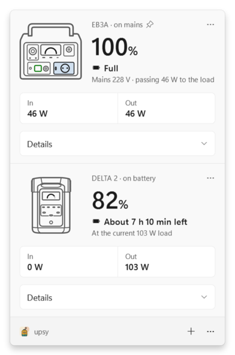
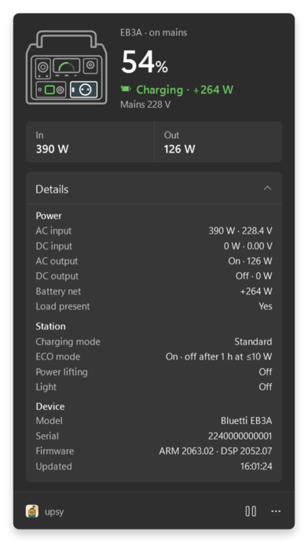
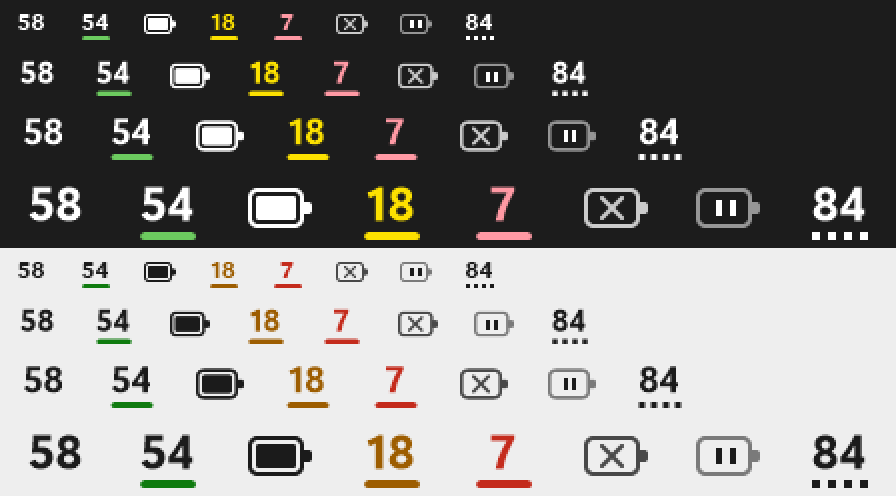

<p align="center">
  
</p>

<h1 align="center">upsy</h1>

<p align="center">
  A Windows tray app that turns portable power stations, the <b>Bluetti EB3A</b> and the <b>EcoFlow DELTA 2</b>, into proper UPS indicators:<br>
  battery percentage, remaining runtime, charging state and alerts when mains drops or the battery runs low.
</p>

---

A small power station makes a good UPS for a desk PC, but its state is only visible on its own little screen, and neither Bluetti nor EcoFlow has an app for Windows. `upsy` reads the stations over Bluetooth LE (no pairing, read-only) and puts them in the notification area. Watch one station or several: the tray icon shows the one you choose, the flyout shows them all.

*Upsy, as in "upsy-daisy", what you say when you catch someone who trips. Upsy catches your PC when the power trips.*

## What you get

| | |
|---|---|
| **Tray icon** | The battery percentage of the station you choose, redrawn for your taskbar theme and DPI. A green bar while charging, amber at your alert threshold, red at 10%, dotted when only the level is known (see EcoFlow below). At 100%, without data and while paused it uses the same Fluent battery glyphs as Windows itself. |
| **Tooltip** | The tray station first, then one line per other station: `EB3A · 100% · on mains` / `DELTA 2 · 82% · 103 W out`. |
| **Flyout** (left-click) | One section per station, the tray station first. Each has a small live drawing of the station (its screen fills to the charge level, active outputs and the feeding input light up), the percentage, runtime or charging state, In/Out power, and a Details section with everything the station reports: AC/DC power and voltage, output switches, settings (ECO mode, charging mode, power lifting, light on the EB3A; charge and discharge limits, X-Boost, AC charging power on the DELTA 2), serial number and firmware. |
| **Menu** (right-click) | Open, Pause for 30 minutes, Show in tray (with several stations), Add station, Start with Windows, low-battery threshold (10-30%), Sign out of EcoFlow, Exit. Each station in the flyout has its own Pause, Show in tray and Forget. |
| **Notifications** | Per station, titled with its name: mains power lost, mains power is back (both debounced 5 s), battery low (your threshold), battery critical (10%). Each fires once per event, never from stale data. |

<p align="center">
  
  
</p>
<p align="center">
  
</p>

## Supported stations

| Station | How upsy reads it | Tested with |
|---|---|---|
| Bluetti EB3A | Modbus register reads, polled every 2 s. Nothing to set up. | ARM 2063.02 / DSP 2052.07 |
| EcoFlow DELTA 2 | An encrypted session, then the heartbeats the station pushes about every second. Needs your EcoFlow account once (see below). | PD 1.2.1.63 |

Both are read-only: upsy never changes an output or a setting.

## Requirements

- Windows 10 2004 (build 19041) or Windows 11, with Bluetooth LE.
- A supported station in Bluetooth range.
- For an EcoFlow station: the EcoFlow account the station is added to in the EcoFlow app, and internet once for signing in.
- To build: the [.NET 10 SDK](https://dotnet.microsoft.com/download/dotnet/10.0) (pinned in `global.json`).

## Run it

```powershell
git clone <this repo>
cd bluetti-battery
pwsh tools/install.ps1            # build, install to %LOCALAPPDATA%\Programs\upsy and start
pwsh tools/install.ps1 -Uninstall # or Settings > Apps > upsy > Uninstall
```

The installer needs no admin rights, only the .NET 10 Desktop Runtime (the SDK includes it). It adds a Start menu shortcut and an entry in Settings > Apps, and fetches the EcoFlow key table (see below). Run it again to update. If **Start with Windows** is on, the autostart entry is moved to the installed copy. For a quick try without installing: `dotnet run --project src/Upsy -c Release`.

No window opens: look for the number in the notification area (it may start in the overflow; drag it onto the taskbar). On first start upsy adds the first supported station it hears and remembers it in `%APPDATA%\upsy\settings.json`. Add more with **Add station** in the right-click menu or the flyout footer. Turn on **Start with Windows** to keep it running.

A station talks to one Bluetooth client at a time, so its phone app and upsy cannot hold it together. Use **Pause for 30 minutes** on that station to hand the link to the phone; upsy resumes by itself and keeps the other stations connected.

## EcoFlow stations

EcoFlow stations share their data only with the EcoFlow account they are added to, and they encrypt the link. Two one-time steps:

1. **Key table.** The session key comes from a constant table in EcoFlow's app. It is EcoFlow's, so it is not in this repository: `pwsh tools/get-ecoflow-keydata.ps1` downloads it from a pinned commit of [ha-ef-ble](https://github.com/rabits/ha-ef-ble), checks its SHA-256 and saves it to `%LOCALAPPDATA%\upsy\ecoflow-keydata.bin`. `tools/install.ps1` does this for you.
2. **Sign in.** When the DELTA 2 shows *Sign-in needed*, choose **Sign in** and enter your EcoFlow email and password. upsy sends them to EcoFlow once, keeps only your account's user ID (encrypted for your Windows account with DPAPI) and never stores the password. After that it works offline. **Sign out of EcoFlow** in the menu deletes the ID.

Until both are done, the DELTA 2 still shows the battery level it advertises, marked *battery level only*: no power, runtime or alerts.

If the station says **Account not accepted**, it remembers a different account. In the EcoFlow app, remove the DELTA 2 and add it again with the same account, then choose **Try again**.

## How it works

```
station --BLE GATT--> WinRtStationTransport --channel--> driver --> StationMonitor --> TrayApp
                      (connect unpaired,               (per model)   (radio, watchdog,   (icon, tooltip,
                       open the model's service)                      backoff, pause)     flyout, menu, alerts)
AdvertisementHub (one scanner): finds stations, follows address changes, reads EcoFlow's advertised level

Upsy.Core (all unit-tested): BluettiDriver (Modbus), EcoFlowDriver (session + Delta2Decoder), StationRegistry,
PowerReading, RuntimeEstimator, AlertMonitor, StatusText, settings v2
```

- **One driver per model.** The monitor is the same for every station; the driver speaks the protocol and returns the same telemetry, identity and settings for every model.
  - The Bluetti driver polls.
  - The EcoFlow driver runs the handshake and then decodes what the station pushes.
- **Derived state.**
  - *On mains* = AC input voltage above 100 V. Power can be 0 W on a live socket when the battery is full.
  - *Charging* = total input minus total output above 10 W, below 100%. This covers solar/DC input too.
  - *Runtime*: the DELTA 2 reports its own time to empty and to full, and upsy uses it. For the EB3A, upsy estimates it as capacity × 0.85 × battery % ÷ discharge power, smoothed over about a minute. Either way it is shown as "about …", rounded to 5 or 10 minutes, only on battery with a load.
- **Resilience.**
  - Retries with backoff up to 30 s.
  - Reconnects after PC sleep and reports Bluetooth off.
  - Drops a link that has been silent too long (20 s for the EB3A, 10 s for the DELTA 2).
  - After a DELTA 2 link ends, waits at least 5 s before reconnecting, because the station refuses service discovery for a few seconds.

### Registers used (EB3A)

| Register | Meaning | | Register | Meaning |
|---|---|---|---|---|
| 10-15 | model (ASCII) | | 43 | battery % |
| 17-20 | serial (4 words, little-endian) | | 48 / 49 | AC / DC output on |
| 23-24 / 25-26 | ARM / DSP firmware | | 77 | AC input voltage ×0.1 V |
| 36 / 37 | DC / AC input W | | 86 | DC input voltage ×0.01 V |
| 38 / 39 | AC / DC output W | | 3034, 3063-3066 | light, ECO, ECO hours, charging mode, power lifting |

### Heartbeat fields used (DELTA 2)

| Heartbeat | Offset | Meaning |
|---|---|---|
| PD | 5, 14, 19 | firmware, battery %, remaining minutes (negative while discharging) |
| PD | 24 / 33 | USB / 12 V output on |
| PD | 25-30, 34 | USB-A, USB-C and 12 V port W (summed as DC output) |
| PD | 112 / 114 / 116 | AC in W / AC out W / solar-car (XT60) in W |
| EMS | 12, 17 / 21, 43 | charge limit, minutes to full / to empty, discharge limit |
| INV | 23, 45, 46 | AC input voltage (mV), AC output on, X-Boost |
| MPPT | 8, 73 | XT60 input voltage (mV), AC charging power |

## Development

```
src/Upsy.Core          pure logic, no Windows UI (net10.0): drivers, protocols, registry, presentation
src/Upsy               tray app: WinRT BLE, WinForms NotifyIcon, WPF flyout and dialogs
tests/Upsy.Core.Tests  xUnit v3 tests on real captures (EB3A registers, DELTA 2 heartbeats) and a fake EcoFlow station
design/                HTML/CSS mock-up of every surface (the UI reference)
assets/                brand (mascot, icon) and the station drawings, as SVG
tools/                 installer, key table fetcher, station glyph generator
openspec/              specs and the changes that built this
```

Quality gate (also run by CI on `windows-latest`):

```powershell
dotnet build upsy.slnx -c Release     # warnings are errors, latest-recommended analyzers
dotnet test --solution upsy.slnx -c Release
dotnet format upsy.slnx --verify-no-changes
```

Useful while working on the UI:

```powershell
# Render every tray icon, flyout state, menu and window, light and dark, to PNG files
src\Upsy\bin\Release\net10.0-windows10.0.19041.0\upsy.exe --render .\preview
# After editing a station outline in assets/station/*-outline.svg
python tools/gen_station_glyph.py
```

Design decisions live in [DESIGN.md](DESIGN.md) and [design/upsy.design.html](design/upsy.design.html) (open it in a browser); product context in [PRODUCT.md](PRODUCT.md).

## Troubleshooting

- **Stays on "Looking for the station".** Make sure the station is switched on and its phone app is closed or paused; a station accepts one Bluetooth client at a time.
- **DELTA 2 says "In use by another app".** It still advertises but refuses the link, usually because the EcoFlow app holds it. Close the app; upsy reconnects by itself.
- **DELTA 2 says "Account not accepted".** Remove the station in the EcoFlow app and add it again with the account you signed in with, then choose Try again.
- **Notifications do not appear.** Windows hides them under Do Not Disturb / Focus. The tray icon still turns amber and red.
- **Going back to an older upsy.** The first start of this version moves `settings.json` to version 2 and keeps the old file as `settings.v1.json`; restore it before running an older build.
- **Something odd happened overnight.** Read `%LOCALAPPDATA%\upsy\upsy.log`.

## Status and roadmap

- **EB3A** works end to end. Mains unplug and replug raise the expected alerts.
- **DELTA 2** is read end to end: handshake, heartbeats and the fields above, checked against the station's screen.
- **Still to verify on hardware:**
  - both stations over hours-long runs;
  - recovery after sleep and after toggling Bluetooth on the PC or a station;
  - handing a station to its phone app with Pause;
  - the DELTA 2's DC port watts under a real load;
  - how toasts behave under Do Not Disturb.
- **To calibrate:** the EB3A runtime's 0.85 factor, from a logged discharge.

Later: other EcoFlow models on the same protocol (DELTA 2 Max, River 2/3, DELTA 3), more Bluetti models, a combined "total backup" view, and hibernating or shutting down the PC at critical charge.

Not affiliated with Bluetti or EcoFlow. "Bluetti", "EB3A", "EcoFlow" and "DELTA 2" are used only to name the devices this tool talks to. Third-party credits: [THIRD-PARTY-NOTICES.md](THIRD-PARTY-NOTICES.md).
