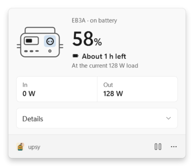

<p align="center">
  
</p>

<h1 align="center">upsy</h1>

<p align="center">
  A Windows tray app that turns a <b>Bluetti EB3A</b> power station into a proper UPS indicator:<br>
  battery percentage, remaining runtime, charging state and alerts when mains drops or the battery runs low.
</p>

---

The EB3A makes a good small UPS for a desk PC, but its state is only visible on its own little screen, and there is no Bluetti app for Windows. `upsy` reads the station over Bluetooth LE (no pairing, no cloud, read-only) and puts it in the notification area.

*Upsy, as in "upsy-daisy", what you say when you catch someone who trips. Upsy catches your PC when the power trips.*

## What you get

| | |
|---|---|
| **Tray icon** | The battery percentage, redrawn for your taskbar theme and DPI. A green bar while charging, amber at your alert threshold, red at 10%. A full-battery glyph at 100%, a crossed-out battery without data, pause bars while paused. |
| **Tooltip** | One line: `EB3A · 58% · 128 W out · about 1 h left`. |
| **Flyout** (left-click) | A small live drawing of the station (its screen fills to the charge level, active outputs and the feeding input light up), the percentage, runtime or charging state, In/Out power, and a Details section with everything the station reports: AC/DC power and voltage, output switches, ECO mode, charging mode, power lifting, light, serial number and firmware. |
| **Menu** (right-click) | Open, Pause for 30 minutes, Start with Windows, low-battery threshold (10-30%), Exit. |
| **Notifications** | Mains power lost, mains power is back (both debounced 5 s), battery low (your threshold), battery critical (10%). Each fires once per event, never from stale data. |

<p align="center">
  
  
</p>
<p align="center">
  
</p>

## Requirements

- Windows 10 2004 (build 19041) or Windows 11, with Bluetooth LE.
- A Bluetti EB3A in Bluetooth range (tested with ARM firmware 2063.02 / DSP 2052.07).
- To build: the [.NET 10 SDK](https://dotnet.microsoft.com/download/dotnet/10.0) (pinned in `global.json`).

## Run it

```powershell
git clone <this repo>
cd bluetti-battery
dotnet run --project src/Upsy -c Release
```

or build once and start the executable:

```powershell
dotnet publish src/Upsy -c Release -o out
.\out\upsy.exe
```

No window opens: look for the number in the notification area (it may start in the overflow; drag it onto the taskbar). On first start upsy scans for a device named `EB3A…`, connects, and remembers its address in `%APPDATA%\upsy\settings.json`. Turn on **Start with Windows** in the right-click menu to keep it running.

The Bluetti phone app and upsy cannot hold the station at the same time. Use **Pause for 30 minutes** to hand the link to the phone; upsy resumes by itself.

## How it works

```
EB3A  --BLE GATT, service 0000ff00-->  WinRtStationTransport  -->  StationMonitor  -->  TrayApp
      write ff02: Modbus "read registers"     (scan, connect,         (radio, connect,      (icon, tooltip,
      notify ff01: response chunks             request/response)       poll 2 s, backoff,     flyout, menu,
                                                                       pause)                 notifications)
                                                 Upsy.Core: Modbus, register decoding, PowerReading,
                                                 RuntimeEstimator, AlertMonitor, StatusText (all unit-tested)
```

- **Protocol.** Modbus RTU (address 1, function 3, CRC16) over two GATT characteristics. Each cycle reads registers 10-49 and 70-90; settings 3034-3066 are read once a minute. upsy never writes a register.
- **Derived state.** The station reports no runtime and no "charging" flag, so upsy derives them:
  - *on mains* = AC input voltage above 100 V (power can be 0 W on a live socket when the battery is full);
  - *charging* = total input minus total output above 10 W, below 100% (covers solar/DC input too);
  - *runtime* = 268 Wh × 0.85 × battery % ÷ discharge power, smoothed over about a minute, shown as "about …" rounded to 5/10 minutes, only on battery with a load.
- **Resilience.** Retries with backoff up to 30 s, reconnects after PC sleep, reports Bluetooth off, and drops a session after three failed reads.

### Registers used (EB3A)

| Register | Meaning | | Register | Meaning |
|---|---|---|---|---|
| 10-15 | model (ASCII) | | 43 | battery % |
| 17-20 | serial (4 words, little-endian) | | 48 / 49 | AC / DC output on |
| 23-24 / 25-26 | ARM / DSP firmware | | 77 | AC input voltage ×0.1 V |
| 36 / 37 | DC / AC input W | | 86 | DC input voltage ×0.01 V |
| 38 / 39 | AC / DC output W | | 3034, 3063-3066 | light, ECO, ECO hours, charging mode, power lifting |

## Development

```
src/Upsy.Core          pure logic, no Windows UI (net10.0)
src/Upsy               tray app: WinRT BLE, WinForms NotifyIcon, WPF flyout
tests/Upsy.Core.Tests  xUnit v3 tests on real captures from the station
design/                HTML/CSS mock-up of every surface (the UI reference)
assets/                brand (mascot, icon) and the station glyph, as SVG
openspec/              specs and the change that built this
```

Quality gate (also run by CI on `windows-latest`):

```powershell
dotnet build upsy.slnx -c Release     # warnings are errors, latest-recommended analyzers
dotnet test --solution upsy.slnx -c Release
dotnet format upsy.slnx --verify-no-changes
```

Useful while working on the UI:

```powershell
# Render every tray icon and flyout state, light and dark, to PNG files
src\Upsy\bin\Release\net10.0-windows10.0.19041.0\upsy.exe --render .\preview
```

Design decisions live in [DESIGN.md](DESIGN.md) and [design/upsy.design.html](design/upsy.design.html) (open it in a browser); product context in [PRODUCT.md](PRODUCT.md).

## Troubleshooting

- **Stays on "Looking for the station".** Make sure the EB3A is switched on and the Bluetti phone app is closed or paused; the station accepts a limited number of Bluetooth clients.
- **Notifications do not appear.** Windows hides them under Do Not Disturb / Focus. The tray icon still turns amber and red.
- **Something odd happened overnight.** Read `%LOCALAPPDATA%\upsy\upsy.log`.

## Status and roadmap

Phase 1 works end to end against a real EB3A: discovery without pairing, live telemetry, identity and settings, tray icon, flyout, menu, notifications. Still to verify on hardware over long runs: hours-long link stability, mains unplug/replug notifications, phone-app coexistence. The runtime estimate's 0.85 factor is to be calibrated from a logged discharge.

Later: hibernate or shut down the PC at critical charge, other Bluetti models, an installer.

Not affiliated with Bluetti. "Bluetti" and "EB3A" are used only to name the device this tool talks to.
